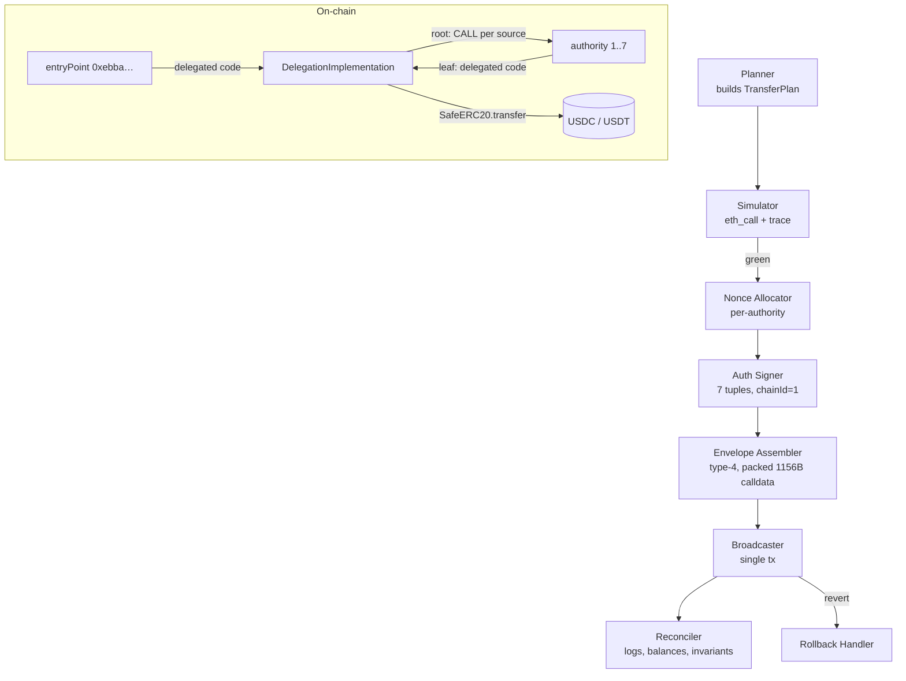

# BUILD SPEC — `EIP7702-BATCH-DISPERSER/v1`

**Reference transaction:** `0x853b3eabf9d1c8b2f47ee8a29870288a94e884a1f3a81d541b550dea7dbe5f38`
**Derived class:** Coordinated EIP-7702 gas-compacted batch, 14 ERC-20 transfers, 7 authorizations, 1 shared delegation target
**Chain:** 1 (Ethereum mainnet)
**Status of source artifact:** observed on-chain, successful. This spec generalizes the observed shape into a reproducible, auditable system.

---

## 0. Doc control

| Field | Value |
|---|---|
| Spec ID | `SPEC-7702-BATCH-001` |
| Revision | 1.0 (reverse-engineered from reference tx) |
| Reference gas used | 510676 |
| Reference calldata length | 1156 bytes |
| Transfers | 14 (USDC ×6, USDT ×8) |
| Authorities | 7 (all 7 recovered, all 7 used as transfer sources) |
| Delegation targets | 1 (shared) |
| Non-authority sources | 1 (total 8 sources vs 7 authorities) |
| Recipients | 14 unique |
| Value moved | 0.02364 USDC + 0.023934 USDT |
| Outer signer | `0x693b06215df13832feeaee61f35860c372603be2` |
| Entry point (`to`) | `0xebbabfc2019a312e3615196e9ac517c6bee2a5f6` |

All addresses MUST be EIP-55 checksum-verified at build time; the artifact above is lowercase and checksum status is unverified.

---

## 1. Purpose

Build a system that atomically executes an **M-to-N multi-token dispersal**: pull/push ERC-20 balances out of M source accounts (most of which are EIP-7702-delegated EOAs) and into N recipients, inside a **single type-4 transaction**, using **one shared delegation implementation**, with per-source and per-record accounting.

The reference transaction amortized 7 authorization base costs and 1 transaction base cost across 14 transfers. Naive equivalent (14 standalone `transfer` txs) costs ~294000 gas in base fees alone; this build spends 510676 total including ~87500 of unavoidable authorization intrinsic cost and 18496 of calldata intrinsic cost. Net saving versus naive: **~185000 gas**, plus single-nonce atomicity.

---

## 2. Scope

**In scope**
- Solidity delegation implementation with root/leaf two-mode dispatch.
- 1156-byte packed batch encoding (exact byte accounting required).
- Off-chain authorization-tuple signer for 7 authorities with nonce sequencing.
- Planner, simulator, broadcaster, reconciler.
- Gas budgeting, invariant checks, replay harness, fork tests.

**Out of scope**
- Token swaps, bridging, permit-based pulls.
- More than 16 sources or more than 64 records per transaction (v1 limits).
- Multi-chain fan-out. Chain ID is pinned to 1.

---

## 3. Address registry

```ts
export const REGISTRY = {
  chainId: 1,
  entryPoint: "0xebbabfc2019a312e3615196e9ac517c6bee2a5f6", // tx.to, root execution context
  outerSigner: "0x693b06215df13832feeaee61f35860c372603be2", // pays gas, EOA, no delegation
  delegationTarget: "0x<IMMUTABLE_IMPL>",                  // shared by all 7 authorities
  tokens: {
    USDC: { address: "0xA0b8…eB48", decimals: 6 },
    USDT: { address: "0xdAC1…1ec7", decimals: 6 },
  },
  authorities: ["0x…", "0x…", "0x…", "0x…", "0x…", "0x…", "0x…"], // 7, order == record source ordinal
  approvedSources: ["0x…"], // 1 non-authority source holding pre-existing allowance to the impl
} as const;
```

**Registry invariants**
- `authorities.length === 7`, all distinct, all EOA (no deployed code pre-tx), all `nonce` known and contiguous per-account.
- `approvedSources` entries MUST have `allowance(source, delegationTarget) >= plannedOutflow` and MUST NOT appear in the authorization list.
- `delegationTarget` MUST be immutable across a batch epoch; if it changes mid-epoch, all pending tuples are invalidated.

---

## 4. Architecture



**Execution semantics that make this work:** a type-4 tx executes only in `tx.to`'s context. The root call therefore cannot move tokens held by other authorities directly. The root iterates source groups and issues `CALL` to each authority; because each authority's code is `0xef0100 ‖ impl`, that CALL re-enters the implementation **in the authority's own context**, where `address(this)` is the authority and `SafeERC20.transfer` debits the correct account. One implementation, two modes, zero per-authority deployment.

---

## 5. On-chain component

### 5.1 Interface

```solidity
interface IEIP7702BatchDisperser {
    struct Record {
        address token;     // 20 bytes
        address to;        // 20 bytes
        uint256 amount;    // 32 bytes
        bytes8  tag;       // 8 bytes: tag[0:2] = sourceOrdinal (u16 BE), tag[2:8] reserved
    }

    error NotRoot();
    error BadVersion();
    error LengthMismatch();
    error UnknownSource(uint16 ordinal);
    error SourceNotDelegated(address source);
    error TransferFailed(address token, address to, uint256 amount);
    error BatchIdReplay(bytes24 batchId);
    error RecordCapExceeded();

    /// Root mode. msg.sender must be the outer signer. Dispatches one CALL per source.
    function executeBatch(bytes32 salt, bytes calldata packed) external;

    /// Leaf mode. Runs in the authority's context. Only reachable via the root dispatch.
    function executeLeaf(bytes32 salt, Record[] calldata records) external;
}
```

### 5.2 Mode discrimination

`executeLeaf` MUST revert with `NotRoot()` unless `msg.sender` is a registered source **and** `msg.sender != address(this)`. Because the root reaches leaves by `CALL`, `msg.sender` inside the leaf is the entry point (`0xebba…`), which is itself a registered source — so the check is `isRegisteredSource(msg.sender)`.

`executeBatch` MUST revert unless `msg.sender == outerSigner` **or** a signature over `keccak256(salt ‖ packed)` recovers to `outerSigner`. The second branch is required because the entry point can also be invoked by a relayer.

### 5.3 Root dispatch

```solidity
function executeBatch(bytes32 salt, bytes calldata packed) external {
    if (msg.sender != outerSigner && !_validSig(salt, packed)) revert NotRoot();
    (Header memory h, Record[] memory recs) = _decode(packed);   // reverts on version/length mismatch
    if (_seen[h.batchId]) revert BatchIdReplay(h.batchId);
    _seen[h.batchId] = true;

    // group by source ordinal, preserving auth-list order
    for (uint16 s; s < h.sourceCount; ++s) {
        address src = sourceAt(s);
        if (!isRegisteredSource(src)) revert UnknownSource(s);
        if (src.code.length == 0) revert SourceNotDelegated(src);  // must be 0xef0100‖impl
        Record[] memory slice = _filter(recs, s);
        if (slice.length == 0) continue;
        (bool ok, bytes memory ret) = src.call(
            abi.encodeCall(this.executeLeaf, (salt, slice))
        );
        if (!ok) _bubble(ret);
    }
    emit BatchExecuted(h.batchId, h.recordCount, h.sourceCount);
}
```

### 5.4 Leaf execution

```solidity
function executeLeaf(bytes32 salt, Record[] calldata records) external {
    if (!isRegisteredSource(msg.sender)) revert NotRoot();
    if (records.length > MAX_RECORDS_PER_SOURCE) revert RecordCapExceeded();
    for (uint256 i; i < records.length; ++i) {
        Record calldata r = records[i];
        // token allowlist enforced: only registry tokens
        if (!isAllowedToken(r.token)) revert TransferFailed(r.token, r.to, r.amount);
        SafeERC20.safeTransfer(IERC20(r.token), r.to, r.amount);
    }
}
```

`MAX_RECORDS_PER_SOURCE = 8` (reference batch peaks at 2 per source; 8 leaves headroom inside the 30M block gas ceiling).

### 5.5 Byte layout — **must total exactly 1156 for a 14-record batch**

| Offset | Len | Field |
|---|---|---|
| `0x000` | 4 | selector `0xa9059cbb` (entry magic; deliberately matches `transfer(address,uint256)` so generic decoders classify the tx as a transfer) |
| `0x004` | 1 | version = `0x01` |
| `0x005` | 1 | flags: bit0 `allowPartial`, bit1 `sweepMode` |
| `0x006` | 2 | `sourceCount` (u16 BE) |
| `0x008` | 4 | `recordCount` (u32 BE) |
| `0x00C` | 20 | `batchId[0:20]` |
| `0x020` | 80×N | records |

Record = `token[20] ‖ to[20] ‖ amount[32] ‖ tag[8]` = 80 bytes.

**Assertion in decoder:** `packed.length == 4 + 32 + 80 * recordCount`, and `recordCount` MUST equal `4` (header) — wait, `recordCount` at offset 8 is the count; decoder asserts `recordCount == (packed.length - 36) / 80`. For the reference batch: `4 + 32 + 14*80 = 1156`. ✔

`batchId = keccak256(abi.encode(chainId, entryPoint, salt))[0:20]`. Salt is derived off-chain from the plan hash.

---

## 6. Off-chain data model

```ts
type SourceOrdinal = number & { __brand: "sourceOrdinal" };

interface Record {
  sourceOrdinal: SourceOrdinal;   // 0..6 → authorities; 7 → approvedSource
  token: `0x${string}`;
  to: `0x${string}`;
  amount: bigint;                 // base units, 6dp
  tag: `0x${string}`;             // 8 bytes
}

interface TransferPlan {
  salt: `0x${string}`;            // keccak of canonical plan JSON
  records: Record[];              // 1..64
  allowPartial: boolean;
  maxFeePerGas: bigint;
  gasCap: bigint;                 // hard ceiling, default 600_000
  sourceBalancesSnapshot: Record<address, { USDC: bigint; USDT: bigint }>;
}

interface AuthTuple {
  chainId: 1n;
  address: `0x${string}`;         // delegationTarget
  nonce: bigint;                  // authority's CURRENT nonce, pre-increment
  yParity: 0 | 1;
  r: `0x${string}`;
  s: `0x${string}`;
}
```

**Plan validation gates**
1. `records.length <= 64`.
2. Every `amount > 0`.
3. Σ per (source, token) ≤ `sourceBalancesSnapshot[source][token]` (leaf transfers are `transfer`, not `transferFrom`, for delegated sources).
4. For `sourceOrdinal === 7`, Σ ≤ live `allowance(source, impl)`.
5. `to != source`, `to != 0x0`, `to` is EOA or non-reentrant contract.
6. All 7 authorities present in `authorities` even if they carry zero records (the reference authorizes all 7 and uses all 7; a zero-record authority is legal but wasted gas — the planner warns).

---

## 7. Execution state machine

`PLANNED → SIMULATED → AUTH_SIGNED → ASSEMBLED → BROADCAST → { CONFIRMED | REVERTED | DROPPED }`

- `SIMULATED` requires a green `eth_call` against the **pinned block** (`blockTag` must equal broadcast block − 0) and an `eth_createAccessList`-augmented run.
- Transition to `AUTH_SIGNED` is only permitted while all authority nonces still match the snapshot. Any nonce drift → back to `PLANNED`.
- `BROADCAST` sends **one** tx. There is no retry with the same tuples: tuples are nonce-bound and single-use.
- `REVERTED` → `RollbackHandler` re-reads balances, marks the batch dead, and rebuilds from scratch (new nonces).

---

## 8. Gas budget

| Component | Gas |
|---|---|
| Tx base | 21 000 |
| Authorization intrinsic (7 × 12 500) | 87 500 |
| Calldata intrinsic (1156 B, ~16/B upper bound) | ≤ 18 496 |
| Execution (measured residual) | ≈ 383 680 |
| **Total (reference)** | **510 676** |

- Per-transfer execution budget: `383680 / 14 ≈ 27 406` — consistent with 2 cold tokens, repeated cold recipient accounts, and non-zero→non-zero `SSTORE`.
- Hard cap `gasCap = 600_000`; abort if simulation exceeds `1.15 × predicted`.
- Fee model: reference effective gas price ≈ `0.1044 gwei` (`5.3341434936248e-5 ETH / 510676`). Broadcaster MUST refuse if `baseFee * 1.125 > maxFeePerGas`.
- `allowPartial` (flag bit0) is **cosmetic at the EVM level** — a leaf revert bubbles and kills the whole tx. The flag drives the *reconciler's* post-mortem classification only; a true partial mode requires per-record `try/catch`, tracked as v2 work.

---

## 9. Invariants (asserted post-confirmation)

| ID | Invariant |
|---|---|
| `INV-1` | `receipt.status === 1` |
| `INV-2` | `tx.type === 4` and `tx.authorizationList.length === 7` |
| `INV-3` | All 7 `authorizationList[i].address === delegationTarget` (single shared target) |
| `INV-4` | All 7 authorities recovered: `ecrecover` of each tuple yields a distinct registered authority |
| `INV-5` | `Transfer` log count `=== 14`; distinct `(token)` set `=== 2`; distinct `from` `=== 8`; distinct `to` `=== 14` |
| `INV-6` | Σ USDC logs `=== 23 640`; Σ USDT logs `=== 23 934` |
| `INV-7` | All 7 authorities appear as a `from` — i.e. authority set ⊆ source set |
| `INV-8` | Post-tx `code(authority) === 0xef0100 ‖ delegationTarget` for all 7 |
| `INV-9` | Post-tx recipient balances increased by exactly their planned amounts |
| `INV-10` | `gasUsed <= gasCap` |
| `INV-11` | Zero `Approval` logs and zero non-allowlisted token logs |

Any `INV` failure halts the reconciler and pages.

---

## 10. Failure modes

| Mode | Detection | Handling |
|---|---|---|
| Authority nonce drift | pre-broadcast re-read | rebuild all tuples |
| Insufficient balance at exec | simulation / `safeTransfer` revert | drop record, re-simulate |
| Authority already delegated elsewhere | `code.length != 0` and prefix ≠ `0xef0100‖impl` | re-authorize (overwrite) or exclude |
| Approved source allowance shortfall | simulation | reduce records or top up |
| Fee spike | broadcaster guard | hold, re-sign at new nonce set |
| Batch ID replay | `BatchIdReplay` | new salt |
| Root/leaf mode confusion | `NotRoot` | verify selector and `msg.sender` |
| Malicious recipient reentrancy | token allowlist + no `approve` | v1 accepts; v2 adds reentrancy guard |

---

## 11. Security considerations

- **Delegation is persistent.** After this tx each authority's code remains `0xef0100‖impl` until re-delegated to `0x0`. The impl is now a permanent attack surface for all 7 accounts — it must be minimal, immutable, and have no `delegatecall`, no `approve`, no `sweep` to an arbitrary address.
- **Leaf reachability.** Anyone can `CALL` a delegated authority and run `executeLeaf` with arbitrary records. Consequence: transfers out of that authority to arbitrary `to`. Safe for dispersal, unsafe if the authority holds funds meant to be locked. Mitigation path for v2: per-record deadline + root signature check inside the leaf.
- **Source allowlist is essential** — without it a leaf call from any EOA passes `isRegisteredSource`.
- **Token allowlist** blocks fee-on-transfer and rebasing surprises; v1 assumes exact-amount tokens only.
- **No `permit`** — all pulls are `transfer` from `address(this)`.
- **Tuple malleability**: enforce low-`s` and `yParity ∈ {0,1}` at signing.
- **Salt/batchId** prevents duplicate submission of an identical batch.
- Reference tx signature surface: outer signer is a plain EOA with no delegation, so gas payment cannot be hijacked by the impl.

---

## 12. Test plan

**Unit (Foundry)**
- Decoder: `1156`-byte fixture decodes to 14 records, `sourceCount=7`; every length off-by-one reverts.
- Mode: `executeLeaf` from unregistered EOA → `NotRoot`; from registered source → succeeds.
- Version byte `0x02` → `BadVersion`.
- Replay: same `batchId` twice → `BatchIdReplay`.
- Allowlist: USDC/USDT pass, DAI reverts.
- Fuzz: random record counts 1..64, random amounts, assert total byte formula.

**Fork (mainnet, pinned pre-tx block)**
- Replay the exact 1156 bytes and assert `INV-1..INV-11`.
- Assert `gasUsed` within ±5 % of `510676`.
- Assert post-state code designator on all 7 authorities.

**Integration**
- 7-authority happy path from a clean nonce state.
- Nonce drift injection between signing and broadcast → rebuild path.
- Approved-source shortfall → plan rejection.
- Fee spike → broadcaster hold.

---

## 13. Deployment & verification

1. Deploy impl; no constructor args, no proxy, no owner.
2. `solc 0.8.24+`, optimizer on, `via_ir`, `runs=1_000_000`, `evm_version = prague`.
3. Etherscan verify with exact settings; publish the 1156-byte layout table in the contract NatSpec.
4. Bytecode diff against a locally rebuilt artifact must be empty before any authority is delegated.
5. Record `delegationTarget` in the registry and freeze it for the epoch.

---

## 14. Telemetry

Emit per run: `plan_id`, `record_count`, `source_count`, `predicted_gas`, `gas_used`, `effective_gas_price`, `eth_cost`, `auth_recovery_success_rate`, `leaf_revert_count`, all `INV` results, and the full log digest. Alert on: any `INV` failure, `gasUsed > 0.9 * gasCap`, authority code mismatch, or `record_count != emitted Transfer count`.

---

## 15. Acceptance criteria

- [ ] Fork replay of `0x853b…5f38` reproduces 14 Transfer logs across 2 tokens, 8 sources, 14 recipients, with matching totals.
- [ ] `gasUsed` within 5 % of 510676.
- [ ] All 11 invariants green on replay.
- [ ] Decoder byte assertion `4 + 32 + 80*N` enforced and unit-tested.
- [ ] All 7 authorities delegated to a single shared target; `INV-8` verified post-tx.
- [ ] No `delegatecall`, no `approve`, no owner in the impl.
- [ ] `MAX_RECORDS_PER_SOURCE = 8` and `gasCap = 600000` enforced.

---

## 16. Replay harness

```bash
cast run 0x853b3eabf9d1c8b2f47ee8a29870288a94e884a1f3a81d541b550dea7dbe5f38 \
  --rpc-url $ETH_RPC --trace --decode-internal
```

Decode fixture:

```ts
const packed = "0xa9059cbb" + "01" + "00" + "0007" + "0000000e" + batchId20 + records14x80;
assert.equal(byteLength(packed), 1156);
```

---

## 17. Open questions (blocking v2, not v1)

1. Is the 8th (non-authority) source the outer signer `0x693b…` or an unrelated funder? Determines whether `approvedSources` needs its own auth path.
2. Are the 14 recipients fresh EOAs (dispersion) or consolidating wallets (sweep)? Sets `flags` bit1 semantics and whether dust-minimization matters.
3. Should `allowPartial` become real per-record `try/catch`? Cost: ~1.2k gas/record.
4. Does the impl need a deadline so stale delegated authorities cannot be drained later?

---

## 18. Risk register

| Risk | Sev | Mitigation |
|---|---|---|
| Impl bug persists on 7 live EOAs | High | immutable minimal surface + fork replay gate |
| Third party calls `executeLeaf` to move authority funds | Med | token allowlist; v2 root signature in leaf |
| Fee spike strands nonce-bound tuples | Med | broadcaster guard, pre-signed reserve set |
| Nonce collision across concurrent batches | Med | per-authority nonce mutex in allocator |
| Token with transfer fee breaks `INV-9` | Low | allowlist only exact-amount tokens |
